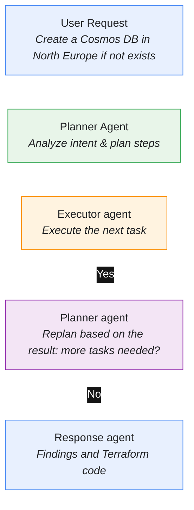
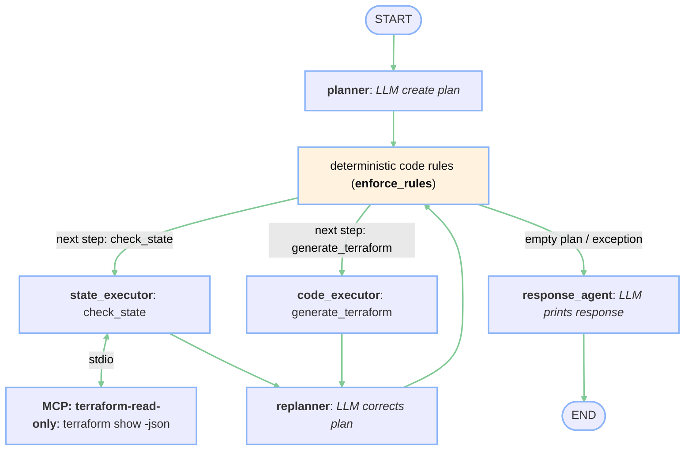
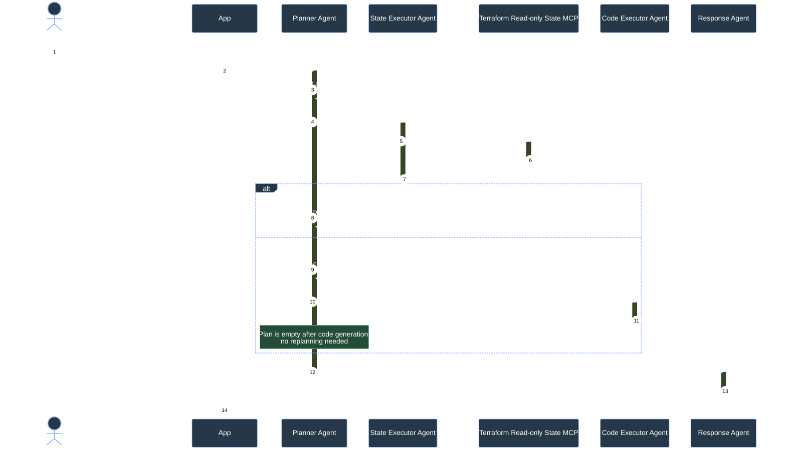
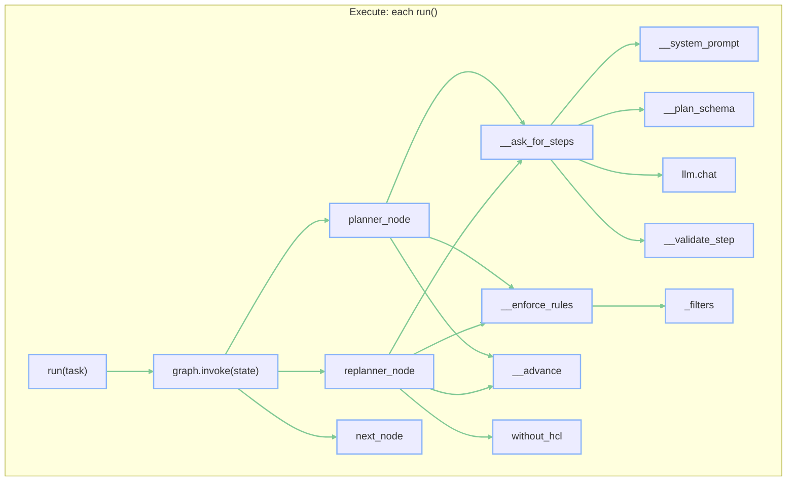

# From Questions to Infrastructure: Building a Planner-Executor Agent with Terraform

In my first post, I want to explore one of the AI architecture patterns: Planner-Executor.

Whenever I need to write Terraform or Azure ARM templates, I find myself looking up the syntax again. Apparently, my brain has decided that remembering every infrastructure resource definition isn't a good use of its storage capacity.

So, I built a small tool to help me with a few recurring tasks: checking what infrastructure already exists and generating code for resources I want to add. For simple lookups, plugging such an MCP server into your coding agent like Claude Code or Codex is enough. The pattern brings more value once you chain more steps, like plan, generate and validate, and that pattern is the focus of this post.

Note: To keep this post focused on the agent architecture, the implementation will be simplified and won't cover security-related aspects. Full code can be downloaded [here](https://github.com/7h4r05/blog-2026-10-25-planner-executor)


## The problem

The goal is to build an agentic workflow that assists with infrastructure development and maintenance.
As a cloud architect I don't want to deep dive into all the resources manually. I don't want to go through Terraform's state files or browse endless resource definitions just to figure out what I can reuse.
Instead I want a quick solution - a tool that I can ask if a resource already exists, and, if it doesn't, helps me generate the Terraform code needed to add it.
Ideally, the workflow should do more than generate code. It should first understand what I'm asking, gather the relevant context, determine the next steps, and then execute those steps in a controlled way.

That's where the Planner-Executor pattern comes in.

## Why Separate Planning and Execution?

Now let's decompose the problem. In the simplest case you may assume that a single agent may have an MCP server that exposes Terraform state and related tools. For this example, we'll assume that the Terraform state is in sync with the actual resources in the Azure subscription we're checking. This simplifies resource discovery by allowing us to rely on the state as our source of truth.

Let's consider two possible tasks:

- Check whether resource exists
- Generate code to create a resource if not exists

A single agent could handle both scenarios, but as more capabilities are added, more problems emerge:

- **Growing context**: The agent may need to process increasingly large amounts of information, including tool outputs, resource metadata, and intermediate results.
- **Too many responsibilities**: The same agent is responsible for understanding the request, deciding what to do, selecting the right tools, interpreting their results, and generating the final code.
- **Limited separation of concerns**: Planning and execution happen within the same agent, making it harder to control, test, and evolve each part independently.

Agents are much more effective and reasonable when they are limited to a well-defined scope instead of being general-purpose, all-in-one systems.
This separation makes the workflow easier to test and extend. It also gives us more flexibility when selecting models for different tasks, which can be useful when building local or on-premises development assistants.
One agent is responsible for planning the work, while the other executes individual steps and reports the results back to the Planner until the main task is completed.

Based on that let's define the use case as follows:



The Planner creates the whole plan once. After every executed step it only corrects the remaining part of the plan, e.g. drops code generation when the resource already exists. Code generation is the last step, so once it's done there is nothing left to replan and the workflow goes straight to the response agent.


## Architecture design

Now that the use case and requirements are defined, let's go deep into more technical aspects.
Because the agents are non-deterministic, it's important to limit their permissions and scope of action to a minimum. 
To do that all of the work around Terraform will be delegated to an MCP server. Although this blog post is not about security around it, it's still a good idea to separate MCP server that can read current Terraform state. Therefore we would define Read-only state Terraform MCP Server. We also need to identify Agents:

- Planner - main agent planning the tasks and replanning after each step
- State executor - uses the MCP server to verify existence of a resource. It's actually not an LLM. The plan steps already contain the filters, so we treat it as a deterministic tool call
- Code executor - LLM agent that generates HCL code
- Response agent - LLM agent that summarizes the results for the user. It's not treated as an executor, the graph calls it once the Planner has no more tasks planned.

An executor in this pattern is anything that can execute one step of the plan and return a result. It may be an LLM agent, but it doesn't have to be - the more steps are deterministic, the more predictable the whole system is.



The output contracts for MCP server should be explicit and defined to make their results predictable and easier for the State Executor to process.

The **Terraform Read-Only State MCP Server** returns information about whether the requested resource exists and, if found, provides its resource ID and resource group. It performs a simple contains query for resource name or location and a resource type match if provided. If no parameter is supplied, it returns all resources.

Expected response:

```json
{
  "exists": true,
  "results": [
    {
    "resource_id": "/subscriptions/.../resourceGroups/XXX/providers/Microsoft.Network/virtualNetworks/XXX",
    "resource_name": "YYY",
    "resource_type": "azurerm_virtual_network",
    "resource_group": "ZZZ",
    "location": "polandcentral"
    }
  ]
}
```

If the resource does not exist, `exists` is set to `false`, and `results` should be an empty collection. This contract gives the Executor a consistent way to interpret tool results and pass them back to the Planner.

Now let's draw a simple use case when a user asks about a Cosmos DB.



## Implementation

Since the architecture and use case are well defined, let's do the implementation. The MCP Server will be created using TypeScript and to keep things simple, for the agents let's use Ollama, Python and LangGraph. In this post you will find only partial snippets of the code, but you can download the whole repository [here](https://github.com/7h4r05/blog-2026-10-25-planner-executor).

Prerequisites:

- [Node.js](https://nodejs.org)
- [Python 3](https://www.python.org/downloads/)
- [Ollama](https://ollama.com)
- [Terraform](https://developer.hashicorp.com/terraform/install) and a directory with an initialized Terraform configuration

First, let's start from the simplest tool - MCP server.

### MCP Read-only state Terraform

Install required libraries

```bash
npm i @modelcontextprotocol/server zod dotenv
npm i -D tsx typescript @types/node
```

I suggest having a separate command to run an inspector inside package.json

```json
"dev:inspect": "npx @modelcontextprotocol/inspector@latest npm run start"
```

First let's define a **TerraformService** that will get the state

```typescript
const execFileAsync = promisify(execFile);

export class TerraformService {
  //...

  async getState(): Promise<TerraformState> {
    const { stdout } = await execFileAsync(
      this.terraformPath,
      ["show","-json"],
      {
        cwd: path.resolve(this.workingDirectory),
        maxBuffer: 10 * 1024 * 1024
      }
    );

    return JSON.parse(stdout) as TerraformState;
  }
}
```

Then in the main file we can define the MCP Server

```typescript
const server = new McpServer({
  name: "terraform-read-only-mcp",
  version: "1.0.0"
});

server.registerTool(
  "terraform_search_state",
  {
    description:
      "Searches the current Terraform state for resources matching " +
      "the optional resource type, name, and Azure location. " +
      "Type filter must match, name or location can be a subset. Searches nested modules too.",
    inputSchema: z.object({
      resourceType: z.string().optional().describe(
        "Terraform resource type, e.g. azurerm_linux_virtual_machine"
      ),
      resourceName: z.string().optional().describe(
        "Terraform or Azure resource name, e.g. web_server"
      ),
      location: z.string().optional().describe(
        "Azure location, e.g. westeurope"
      )
    })
  },
  async ({ resourceType, resourceName, location }) => {
    try {
      const state = await terraform.getState();
      // ... collect resources from the root module and all child modules

      // Azure regions appear as "westeurope" in state and "West Europe" in prompts.
      const normalize = (value: string) =>
        value.toLowerCase().replace(/[\s_-]/g, "");

      const matches = resources.filter((resource) => {
        if (
          resourceType &&
          resource.type?.toLowerCase() !== resourceType.toLowerCase()
        ) {
          return false;
        }

        if (resourceName) {
          // Match the Terraform address name and the Azure resource name.
          const azureName = resource.values?.name;
          const names = [
            resource.name,
            typeof azureName === "string" ? azureName : ""
          ];

          if (
            !names.some((name) =>
              normalize(name).includes(normalize(resourceName))
            )
          ) {
            return false;
          }
        }

        if (location) {
          const resourceLocation = resource.values?.location;

          if (
            typeof resourceLocation !== "string" ||
            !normalize(resourceLocation).includes(normalize(location))
          ) {
            return false;
          }
        }

        return true;
      });

      // ... map matches to the contract shown above:
      // { exists, results: [{ resource_id, resource_name, resource_type, resource_group, location }] }
      return {
        content: [{ type: "text" as const, text: JSON.stringify(result) }]
      };
    } catch (error) {
      return {
        isError: true,
        content: [{ type: "text" as const, text: `Failed to search Terraform state: ${error}` }]
      };
    }
  }
);

await serveStdio(() => server);
```

The server supports one entry point and retrieves the state using TerraformService, then it performs a trivial search over the returned state. Locations and names are normalized, because the model will pass "WestEurope" or "West Europe", while the state contains "westeurope". We could apply filters in the command line using tools like grep, but that would require additional security. In this approach we operate just on the text result and limit access to real system to minimum. The response contains only five fields per resource, so the rest of the state, including potentially sensitive values, never reaches the LLM. This kind of MCP Server you can easily integrate with your preferred coding agents.

### Agents

The architecture around the agent communication has already been defined. Planner analyzes the request and plans the work across two executors: State and Code. Each executor has its own responsibility. When the plan is completed, the Response agent summarizes the results.
Let's initiate the project by adding requirements.txt.


```text
mcp
langgraph
```

Then we can define a base class for Agents.

```python

from abc import ABC, abstractmethod


class BaseAgent(ABC):
    name = "base"
    description = "Base agent."

    def __init__(self, llm=None):
        self.llm = llm

    @abstractmethod
    def run(self, task):
        raise NotImplementedError
```

The most important class in the project will be the Planner class. The planner will use LangGraph to create a graph of calls, planning calls & replanning after each call. Since that's a huge amount of code, I will start with a scheme of calls and then show only the parts that make the pattern work.



#### The plan is data

The Planner itself doesn't execute any actions, it creates a list of steps. Each step is defined as an action and its filters. The list is not hardcoded, but it's created with LLM based on the request and the supplied list of executors inserted to a graph of tools. Thanks to that approach it can be easily extended with more steps.

```python
self.executors = {
    agent.tool_name: agent
    for agent in agents
    if getattr(agent, "tool_name", None)
}
```

When calling Ollama I define an expected output JSON schema. By passing a list of executors as `enum` on `action` the response shouldn't "invent" new executors:

```python
def __plan_schema(self) -> dict[str, Any]:
    nullable_string = {"type": ["string", "null"]}
    return {
        "type": "object",
        "properties": {
            "steps": {
                "type": "array",
                "items": {
                    "type": "object",
                    "properties": {
                        "action": {
                            "type": "string",
                            "enum": list(self.executors),
                        },
                        "resourceType": nullable_string,
                        "resourceName": nullable_string,
                        "location": nullable_string,
                        "reason": {"type": "string"},
                    },
                    "required": ["action", *FILTER_FIELDS, "reason"],
                },
            },
        },
        "required": ["steps"],
    }
```

This approach is very flexible. New executors, like a **validator**, could be easily added just by putting them in the `AgentManager`. The graph and the response schema will follow.

#### Executors

First executor that is expected to be run is State Executor. It's also an interesting example that not all executors have to use LLM. This one is just responsible for calling MCP Server in a deterministic way. It already has a task context from the Planner initial call evaluation, so we can reuse that and provide a deterministic call:

```python
class StateExecutor(BaseAgent):
    name = "state_executor"
    tool_name = "check_state"
    description = (
        "Search Terraform state for a resource using optional "
        "type, name, and location filters."
    )

    def run(self, task):
        payload = self.mcp_client.search_state(
            resource_type=task.get("resourceType"),
            resource_name=task.get("resourceName"),
            location=task.get("location"),
        )

        exists = payload.get("exists")
        results = payload.get("results")

        if not isinstance(exists, bool):
            raise ValueError("Missing or invalid 'exists' field.")
        if not isinstance(results, list):
            raise ValueError("Missing or invalid 'results' field.")
        # ...
```

Every executor appends its result to the shared `history` in the graph state, as well as the action and the parameters. It's used for the replanner to reason about.

#### The prompt is a suggestion, code is a guarantee

The prompt tells the Planner to check the state before generating code. With a small local model (I used `qwen2.5:7b`) that's usually not enough. While testing this solution I received skipped checks, repeated steps that already succeeded or generated HCL code even when the resource was found. That's why it's always worth not letting the planner and replanner do the work on their own, but to enforce some deterministic rules before anything is executed:

```python
def __enforce_rules(self, steps, history):
    """Deterministic plan rules that a small model cannot be trusted with."""
    succeeded = [item for item in history if item.get("status") == "success"]
    done = {(item["action"], _filters(item["parameters"])) for item in succeeded}
    checked = {
        _filters(item["parameters"])
        for item in succeeded
        if item["action"] == "check_state"
    }
    managed = {
        _filters(item["parameters"])
        for item in succeeded
        if item["action"] == "check_state"
        and item["output"].get("exists") is True
    }

    plan = []
    for step in steps:
        key = (step["action"], _filters(step))
        if key in done:
            continue  # already succeeded

        if step["action"] == "generate_terraform":
            if _filters(step) in managed:
                continue  # resource is already in the state
            if _filters(step) not in checked:
                # the model skipped the state check, add it
                plan.append({**step, "action": "check_state"})
        checked.add(_filters(step))
        plan.append(step)
        done.add(key)

    budget = MAX_PLAN_STEPS - len(history)
    return plan[:max(budget, 0)]
```

This snippet is just a shortened version of the full one which also drops too vague checks.
This is where the separation of planning and execution matters - keep the plan as a plain list, correct/validate it by the code.

#### Replanning

After each executor the graph goes back to the replanner. It sends the request, the executed steps and the remaining plan to the LLM and gets back the steps that still need to run. In this example it may not bring the value directly, although in the second test it's the replanner that dropped code generation, and if it gets extended by validators or a Terraform (Save) Plan MCP it would make a much bigger impact.

```python
def replanner_node(state: WorkflowState) -> dict:
    history = state.get("history", [])

    if history and history[-1].get("status") == "error":
        return self.__advance([])

    # Generated code brings no new facts about the infrastructure,
    # so an empty plan after it needs no extra LLM call.
    if not state.get("plan") and history[-1]["action"] == "generate_terraform":
        return self.__advance([])

    steps = self.__ask_for_steps(
        self.REPLAN_PROMPT,
        {
            "user_request": state["user_request"],
            "executed_steps": without_hcl(history),
            "remaining_plan": state.get("plan", []),
        },
    )
    steps = self.__enforce_rules(steps, history)
    return self.__advance(steps)
```

Routing is extremely simple. Just go to the executor of the current step, otherwise go to Response Agent.

```python
def next_node(state: WorkflowState) -> str:
    step = state.get("current_step")
    if not step:
        return self.responder.name
    return self.executors[step["action"]].name
```

#### Keep large artifacts out of the loop

Generated HCL can be long, and the replanner only needs to know whether a step succeeded. So before the history is sent to an LLM, the code is removed from it:

```python
def without_hcl(history):
    return [
        {
            **item,
            "output": {
                key: value
                for key, value in item["output"].items()
                if key != "hcl"
            },
        }
        if isinstance(item.get("output"), dict)
        else item
        for item in history
    ]
```

The same applies to the Response agent. It writes the summary, but it's important that generated HCL is not modified. Especially with small models it may be incorrectly "fixed". To mitigate that issue, let's just add HCL to the response by code.

#### Testing the deterministic rules

Testing LLM responses is a more complex task so to avoid overcomplicating this post, I'll deal only with deterministic testing. That can be easily done for cases like: using a fake LLM that returns bad plans on purpose or an in-memory Terraform state, without Ollama or Terraform:

```python
def test_generation_dropped_when_resource_is_in_state(self):
    llm, result, _ = run_workflow(
        [
            [step("check_state"), step("generate_terraform")],
            [step("generate_terraform")],  # model ignores the state result
        ],
        managed_names=["prod-db"],
    )

    self.assertEqual(executed(result), [("check_state", "success")])
    self.assertNotIn("code", llm.calls)
```


## Testing e2e

Let's live test the LLM for both scenarios, whether there's a resource or not. 
First case - resource doesn't exist - create:

```bash
Describe the infrastructure request: create cosmosdb in west europe
[2026-10-24T17:22:40.829Z] Planner agent started
[2026-10-24T17:22:40.844Z] Node executed:  {"node": "planner"}
[2026-10-24T17:22:43.149Z] Planner: adding missing state check {"action": "generate_terraform", "resourceType": "azurerm_cosmosdb_account", "resourceName": null, "location": "WestEurope", "reason": "User requested to create a CosmosDB in West Europe."}
[2026-10-24T17:22:43.149Z] Planner: plan created [{"action": "check_state", "resourceType": "azurerm_cosmosdb_account", "resourceName": null, "location": "WestEurope", "reason": "Check Terraform state before generating configuration."}, {"action": "generate_terraform", "resourceType": "azurerm_cosmosdb_account", "resourceName": null, "location": "WestEurope", "reason": "User requested to create a CosmosDB in West Europe."}]
[2026-10-24T17:22:43.150Z] Node executed:  {"node": "state_executor"}
◇ injected env (2) from .env
[2026-10-24T17:22:43.952Z] Terraform MCP server started
[2026-10-24T17:22:43.969Z] Searching Terraform state {"resourceType":"azurerm_cosmosdb_account","location":"WestEurope"}
[2026-10-24T17:22:46.095Z] State received
[2026-10-24T17:22:46.095Z] No matching Terraform resource found
[2026-10-24T17:22:46.101Z] MCP: parsed response successfully.
[2026-10-24T17:22:46.123Z] State executor finished
[2026-10-24T17:22:46.125Z] Node executed:  {"node": "replanner"}
[2026-10-24T17:22:49.083Z] Replanner: updated plan [{"action": "generate_terraform", "resourceType": "azurerm_cosmosdb_account", "resourceName": null, "location": "WestEurope", "reason": "User requested to create a CosmosDB in West Europe."}]
[2026-10-24T17:22:49.086Z] Node executed:  {"node": "code_executor"}
[2026-10-24T17:22:57.253Z] Code executor finished
[2026-10-24T17:22:57.257Z] Node executed:  {"node": "replanner"}
[2026-10-24T17:22:57.258Z] Replanner: plan completed
[2026-10-24T17:22:57.258Z] Node executed:  {"node": "response_agent"}
[2026-10-24T17:23:02.133Z] Planner finished
[2026-10-24T17:23:02.133Z] 
The workflow completed successfully. No existing CosmosDB resources were found in the Terraform state, and the configuration for creating a CosmosDB account in West Europe has been generated. The next steps would typically involve reviewing and applying the generated Terraform configuration to deploy the CosmosDB resource. 

Generated configuration and resources:
- Action: Generate Terraform configuration for `azurerm_cosmosdb_account` in West Europe.

```hcl
{"resourceType":"azurerm_cosmosdb_account","resourceName":null,"location":"WestEurope","hcl":"resource "azurerm_cosmosdb_account" "example" {
  name                = "example-cosmosdb"
  location            = "WestEurope"
  resource_group_name = existing_resource_group.name
  offer_type          = "Standard"
  kind                = "GlobalDocumentDB"
  consistency_policy {
    enabled              = true
    consistency_level    = "Session"
  }
}

output "cosmosdb_connection_string" { value = azurerm_cosmosdb_account.example.connection_string }
output "cosmosdb_name" { value = azurerm_cosmosdb_account.example.name }
","assumptions":["existing_resource_group.name"]}
```

The tool properly found that the resource doesn't exist and suggested HCL code to create it. However after a close look we can spot limitations to this approach.
First, the Code Executor put its whole JSON response into the `hcl` field, so the injected code has some rubbish around it. The HCL itself has some invalid fields like 'enabled' is not an argument for 'consistency_policy', and required 'geo_location' is missing. The HCL code was properly injected without being modified by the Response Agent.

Another problem here is the Response Agent. Its prompt explicitly contains "Do not recommend terraform apply", yet it suggests "reviewing and applying the generated Terraform configuration".

These errors could possibly be fixed by introducing more executors like Validator Executor which could run `terraform fmt` and `terraform validate`.

The deterministic rules would need one change: a generation that failed validation must not be treated as a repeated step that already succeeded. This also shows why the pattern is worth its overhead - validation is just another step in the plan, that can be injected without changing any of the other steps. The loop is limited by `MAX_PLAN_STEPS` so there's a strict limit against endless reasoning.

Second case - resource exists:

```bash
[2026-10-24T17:21:30.359Z] Adding agent 'state_executor' to the workflow graph
[2026-10-24T17:21:30.359Z] Adding agent 'code_executor' to the workflow graph
[2026-10-24T17:21:30.359Z] Adding agent 'response_agent' to the workflow graph

Describe the infrastructure request: create cosmosdb account in polandcentral
[2026-10-24T17:21:37.334Z] Planner agent started
[2026-10-24T17:21:37.340Z] Node executed:  {"node": "planner"}
[2026-10-24T17:21:44.364Z] Planner: adding missing state check {"action": "generate_terraform", "resourceType": "azurerm_cosmosdb_account", "resourceName": null, "location": "polandcentral", "reason": "Generate Terraform HCL for the requested CosmosDB account."}
[2026-10-24T17:21:44.365Z] Planner: plan created [{"action": "check_state", "resourceType": "azurerm_cosmosdb_account", "resourceName": null, "location": "polandcentral", "reason": "Check Terraform state before generating configuration."}, {"action": "generate_terraform", "resourceType": "azurerm_cosmosdb_account", "resourceName": null, "location": "polandcentral", "reason": "Generate Terraform HCL for the requested CosmosDB account."}]
[2026-10-24T17:21:44.369Z] Node executed:  {"node": "state_executor"}
◇ injected env (2) from .env
[2026-10-24T17:21:45.562Z] Terraform MCP server started
[2026-10-24T17:21:45.587Z] Searching Terraform state {"resourceType":"azurerm_cosmosdb_account","location":"polandcentral"}
[2026-10-24T17:21:48.260Z] State received
[2026-10-24T17:21:48.261Z] Matching Terraform resources found 1
[2026-10-24T17:21:48.265Z] MCP: parsed response successfully.
[2026-10-24T17:21:48.287Z] State executor finished
[2026-10-24T17:21:48.288Z] Node executed:  {"node": "replanner"}
[2026-10-24T17:21:50.824Z] Replanner: updated plan []
[2026-10-24T17:21:50.825Z] Node executed:  {"node": "response_agent"}
[2026-10-24T17:21:55.338Z] Planner finished
[2026-10-24T17:21:55.338Z] 
A CosmosDB account in the Poland Central region already exists with the name `XXX` in the resource group `XXX`. No new Terraform configuration was generated because the requested resource already exists in the specified location. 

Generated HCL is not included in this response.

Resources found in Terraform state:
- XXX (azurerm_cosmosdb_account), resource group: XXX, location: polandcentral
  id: /subscriptions/XXX/resourceGroups/XXX/providers/Microsoft.DocumentDB/databaseAccounts/XXX
```

The tool found that the resource exists and returned its details just as intended.

## Conclusions

In this article I presented the Planner-Executor pattern on a small but practical example: an assistant that checks the Terraform state and generates the code for missing Azure resources. Although the example looks trivial, even in such an example there were a few problems that arose when running it on small models.

1. A prompt is a suggestion, never a guarantee. With a small local model, rules written in the prompt weren't always followed. Even a simple agent like Response Agent ignores some of the rules. This is a great example that you should never fully trust the prompt result, but for critical paths it's important to have a **deterministic code** approach (`__enforce_rules`) to make the workflow more reliable without changing the model. The plan is proposed by the LLM, but the code validates what is actually executed.

2. Not every executor needs an LLM. The State executor is a plain tool call. Also the routing between nodes is deterministic as well. The LLM is used only where it adds real value: planning, generating code and writing the summary. The fewer non-deterministic steps it has, the easier it is to reason about.

3. This pattern has a cost. A simple request takes four LLM calls and about 20 seconds on a local model. For a one-off lookup, plugging the MCP server into a coding agent is simpler and faster, but if you plan to create a bigger and more reliable solution the Planner may bring more value. Especially if you want to extend it with multiple steps: Validator, Plan-Save, Verify-Drift and so on... This provides a pluggable way of extending a solution based on the Planner-Executor architecture.

4. The live tests showed that the workflow can confidently return HCL that wouldn't pass `terraform validate`. There's a great area for improvement here that can be easily extended by adding validation steps.

One of the biggest advantages of this pattern is that extending it doesn't require rewriting existing agents. It's a nice example of the Open-Closed Principle. A validator, a drift check against Azure or a cost estimation is just another executor with its own action that can be added anytime without interfering with the current implementation.
