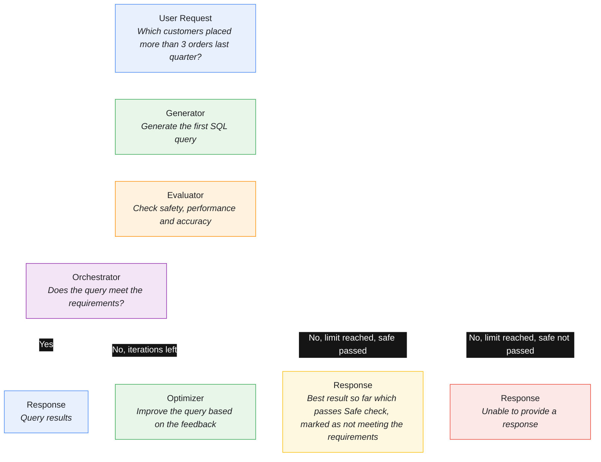
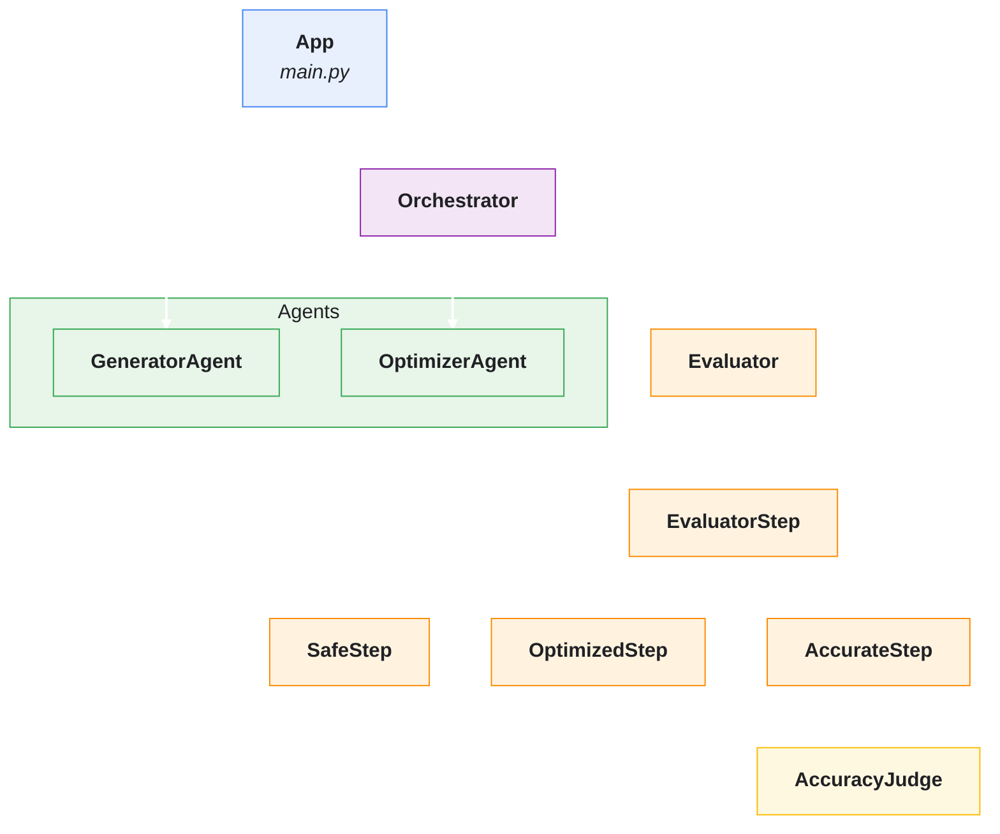

# Evaluator-Optimizer

In my previous post I described Planner-Executor pattern. This time I'd like to write about a different pattern called Evaluator-Optimizer. This pattern is used when we want to provide a response based on specific evaluation requirements. The requirements should be clear enough and measurable. The Evaluator doesn't necessarily have to be an LLM; it could be a workflow based on MCP, plain code or combination of any. What matters is that it generates a score. In the simplest case we can have 2 agents: Generator and Evaluator. Sometimes we introduce Optimizer as a separate agent, for example in cases where we need a different prompt for a result improvement based on evaluation results. The post will not contain full implementation to keep it as simple as possible. You can download the repository from [here](https://github.com/7h4r05/blog-2026-11-08-evaluator-optimizer).

## Generator

Generator is the first step of the journey. Its main responsibility is to generate the first response. That response will be the base for the future optimization.

## Evaluator

The Evaluator checks the generated result against the requirements. It can be performance requirements, code syntax or an expected result structure. The Evaluator then returns a score or a pass/fail result, along with specific feedback on what needs to be changed.

## Optimizer

Optimizer expects the result from Evaluator and the current result. It needs to have a clear way to improve the result to meet the Evaluator criteria. Once a new result is generated, it goes back to the Evaluator.

## The loop

The loop is a workflow orchestrator that executes Evaluator<->Optimizer until the result meets requirements or iteration limit is reached. If the iteration limit is reached and the result doesn't satisfy the condition, orchestrator should decide what to do next. In this example we decide to return the best result so far meeting the safe criteria with an annotation that it doesn't meet the requirements. If none pass the safe criteria, the agent should respond to the user that it's unable to provide a result.

## The result

Once the query is built we want it to be executed and we want it to support relative dates within the queries like: *Show me customers having orders within last month*. Test execution below from 8 November 2026.

```text
What query should I prepare?
Show me customers having orders within last month
SQL Result: SELECT c.id, c.name FROM customers c JOIN orders o ON c.id = o.customer_id WHERE o.ordered_at >= '2026-10-01' AND o.ordered_at < '2026-11-01' LIMIT 100
Executing results...
(11, 'Oskar Johansson')
(38, 'Mia Becker')
(25, 'Daan Jansen')
(3, 'Mia Schneider')
(16, 'Tomasz Mazur')
(39, 'Jakub Dvořák')
(6, 'Elsa Andersson')
(15, 'Chloé Martin')
(40, 'Katarzyna Lewandowski')
(3, 'Mia Schneider')
(37, 'Daan de Vries')
(31, 'Felix Becker')
(24, 'Chiara Russo')
(35, 'Giulia Ferrari')
(13, 'Katarzyna Wojcik')
(7, 'Chiara Ferrari')
(16, 'Tomasz Mazur')
(25, 'Daan Jansen')
(18, 'Tomasz Kowalczyk')
(35, 'Giulia Ferrari')
(35, 'Giulia Ferrari')
(7, 'Chiara Ferrari')
(16, 'Tomasz Mazur')
(27, 'Tiago Santos')
(28, 'Camille Dubois')
(28, 'Camille Dubois')
```

Notice that it has duplicates: the query joins `orders` without `DISTINCT`. I'll get back to it in the conclusions.

## The problem: Text-to-SQL

Let's define a case when we want to provide a way for a non-technical person to create queries against a SQL database. This person can't verify the generated SQL, so a wrong query can produce incorrect results. Let's define three criteria:

- Safe - it only allows reading data. The Evaluator rejects everything besides SELECT queries. It's validated against sqlglot and checks with `EXPLAIN QUERY PLAN` that the database can run it. Additionally, the connection to the database is read-only. This is the first check.
- Optimized - avoid full scans of large tables and limit the number of returned rows, and use explicit columns instead of `SELECT *`.
- Accurate - the result actually answers the user's question

Accuracy is the hardest requirement to verify. A full solution needs a set of test questions with expected results, so in this post I'll limit it to a simple LLM check. That means a query may pass while it's still wrong.



## Project structure

Now that the use case is clear, let's look at how to structure the project and define the key elements in detail. We will define 2 agents, a workflow orchestrator loop, an evaluator as a pipeline of steps including an LLM-as-judge.



## The Evaluator implementation

From my point of view, the Evaluator is the most crucial part of this algorithm. It is the most deterministic part except for the accuracy step. The request should contain the user's original question, the generated SQL to evaluate and a database schema. Each step should return a similar result that says whether it passed and, if not, how to improve the query. Let's define a base class for all steps so it can be extended in the future.

```python
@dataclass(frozen=True)
class EvaluationRequest:
    question: str
    sql: str
    db_schema: str


class EvaluationResult:
    is_mandatory: bool
    score: float
    passed: bool
    description: str
    # __init__ stores the fields and validates score with validate_score
    ...

    @staticmethod
    def validate_score(name: str, score: float) -> float:
        if not math.isfinite(score) or not 0.0 <= score <= 1.0:
            raise ValueError(f"{name} must be a finite number between 0 and 1.")
        return score


class EvaluatorStep(ABC):
    IS_MANDATORY: ClassVar[bool]
    MIN_PASS_SCORE: ClassVar[float]
    MAX_PASS_SCORE: ClassVar[float]

    @abstractmethod
    def evaluate(self, data: EvaluationRequest) -> EvaluationResult:
        pass

    def is_score_passed(self, score: float) -> bool:
        return self.MIN_PASS_SCORE <= score <= self.MAX_PASS_SCORE

    def _result(self, score: float, description: str) -> EvaluationResult:
        return EvaluationResult(
            self.IS_MANDATORY,
            score,
            self.is_score_passed(score),
            description,
        )
```

Each step implementation should define its own requirements when the score passes and if the step is mandatory. I decided to let each step define its mandatory requirement on its own. In many real-world scenarios that could be a wrong approach and the requirement should be injected from configuration, but I decided to define it this way for the sake of simplicity.

The Evaluator is defined as a pipeline: if a mandatory step fails, it stops and returns only that result.

```python
class Evaluator:
    def __init__(self, steps: list[EvaluatorStep]):
        self.steps = steps

    def evaluate(self, data: EvaluationRequest) -> list[EvaluationResult]:
        results = []
        for step in self.steps:
            result = step.evaluate(data)
            if not result.passed and result.is_mandatory:
                return [result]
            results.append(result)
        return results
```

### Evaluator step dependencies

Now for the definition of `OptimizedStep` and for `SafeStep` we will need to verify the SQL itself using some deterministic tool like `sqlglot` and the database query plan. `AccurateStep` on the other hand will use LLM-as-judge. I will skip those implementations here. You can download them from the full [repository](https://github.com/7h4r05/blog-2026-11-08-evaluator-optimizer). Instead I'll just list the contracts the steps rely on.

For the `AccurateStep` we defined `AccuracyAssessment` as a result and a contract `AccuracyJudge` that performs evaluation.

```python
@dataclass(frozen=True)
class AccuracyAssessment:
    score: float
    feedback: str


class AccuracyJudge(Protocol):
    def evaluate(
        self,
        *,
        question: str,
        sql: str,
        schema: str | None,
    ) -> AccuracyAssessment: ...
```

For the deterministic database checks we define a `QueryPlanChecker` that returns whether the query passes the test and, if not, what the problem is.

```python
class QueryPlanChecker(Protocol):
    def __call__(self, sql: str, dialect: str) -> tuple[bool, str]: ...
```

### Evaluator steps implementation

Now that the contracts and the dependencies are in place, we can implement all the steps: `SafeStep`, `OptimizedStep` and `AccurateStep`.

```python
class SafeStep(EvaluatorStep):
    IS_MANDATORY = True
    MIN_PASS_SCORE = 1.0
    MAX_PASS_SCORE = 1.0

    def __init__(self, query_checker: QueryPlanChecker, dialect: str = "sqlite") -> None:
        self.dialect = dialect
        self.query_checker = query_checker

    def evaluate(self, data: EvaluationRequest) -> EvaluationResult:
        sql, input_error = extract_sql(data.sql)
        if input_error:
            return self._result(0.0, input_error)

        _, validation_error = parse_read_only_select(sql, self.dialect)
        if validation_error:
            return self._result(0.0, validation_error)
        query_error = self.query_checker(sql, self.dialect)
        if query_error[0] is False:
            return self._result(0.0, query_error[1])

        return self._result(
            1.0,
            "The query is one parseable, read-only SELECT statement.",
        )
```

`SafeStep` is the first and mandatory step. It checks whether the query is a read-only query (`parse_read_only_select`), then using `QueryPlanChecker` it verifies using **EXPLAIN** if the query can be executed.

Optimized step is another deterministic step with three checks:

- **Bounded `LIMIT`** - the query must have a `LIMIT` and it must not exceed `max_rows`. The exception is an aggregate without `GROUP BY` like `SELECT SUM(total) FROM orders`.
- **Explicit columns** - no `SELECT *`, so the query should return only what was asked for.
- **No full scan of a large table** - `QueryPlanChecker` runs `EXPLAIN QUERY PLAN` and fails when SQLite would scan a whole table with at least 100 rows instead of using an index.

The score is a fraction of passed checks. The pass score is defined as 0.7, but with three checks having the same weights it requires all of them to pass. It can be adjusted based on the results.

```python
class OptimizedStep(EvaluatorStep):
    IS_MANDATORY = False
    MIN_PASS_SCORE = 0.7
    MAX_PASS_SCORE = 1.0

    def __init__(
        self,
        max_rows: int = 1000,
        dialect: str = "sqlite",
        plan_checker: QueryPlanChecker | None = None,
    ) -> None:
        if max_rows < 1:
            raise ValueError("max_rows must be greater than zero.")

        self.max_rows = max_rows
        self.dialect = dialect
        self.plan_checker = plan_checker

    def evaluate(self, data: EvaluationRequest) -> EvaluationResult:
        sql, input_error = extract_sql(data.sql)
        if input_error:
            return self._result(0.0, input_error)

        query, validation_error = parse_read_only_select(sql, self.dialect)
        if validation_error:
            return self._result(
                0.0,
                f"Cannot assess optimization: {validation_error}",
            )

        checks: list[tuple[bool, str]] = [
            self._has_bounded_limit(query),
            self._has_explicit_columns(query)
        ]

        if self.plan_checker is None:
            checks.append(
                (
                    False,
                    "A query plan checker is required to verify full-table scans.",
                )
            )
        else:
            no_full_scan, feedback = self.plan_checker(sql, self.dialect)
            if not isinstance(no_full_scan, bool) or not isinstance(feedback, str):
                raise TypeError(
                    "plan_checker must return a (bool, str) tuple."
                )
            checks.append((no_full_scan, feedback))

        score = sum(passed for passed, _ in checks) / len(checks)
        description = " ".join(
            feedback if passed else f"Failed: {feedback}"
            for passed, feedback in checks
        )
        return self._result(score, description)
    ...
    # the rest of implementation goes here
```

The last step will be `AccurateStep`. This step uses LLM-as-judge to generate `AccuracyAssessment` to define the accuracy of the result. It relies on the contract of `AccuracyJudge` so a different LLM-as-judge can be plugged in. In this example `OllamaAccuracyJudge` asks the model to review the created SQL and score it from 0 to 1, with feedback on what must change.

```python
SCHEMA = {
    "type": "object",
    "properties": {
        "score": {"type": "number", "minimum": 0.0, "maximum": 1.0},
        "feedback": {"type": "string"},
    },
    "required": ["score", "feedback"],
}

SYSTEM_PROMPT = (
    "You review SQL written for a non-technical user. Do not run the query. "
    "Score from 0 to 1 how well it answers the question. "
    "LIMIT is required by a separate check, so do not lower the score for it. "
    "In feedback, name exactly what must change, or confirm that it is correct."
)


class OllamaAccuracyJudge:
    def __init__(self, client: OllamaClient) -> None:
        self.client = client

    def evaluate(
        self,
        *,
        question: str,
        sql: str,
        schema: str | None
    ) -> AccuracyAssessment:
        content = self.client.chat(
            messages=[
                {"role": "system", "content": SYSTEM_PROMPT},
                {
                    "role": "user",
                    "content": (
                        f"Today is {date.today().isoformat()}.\n"
                        f"Question: {question}\n"
                        f"Schema: {schema or 'not provided'}\n"
                        f"SQL: {sql}"
                    ),
                },
            ],
            schema=SCHEMA,
        )
        answer = json.loads(content)
        score = min(max(float(answer["score"]), 0.0), 1.0)

        return AccuracyAssessment(score=score, feedback=str(answer["feedback"]))
```

Without explicit mention of `LIMIT` the judge often lowered the score for it, therefore I explicitly asked it to skip it in this check as this is part of the `OptimizedStep`. 

`AccurateStep` calls the judge and turns its assessment into an `EvaluationResult`:

```python
class AccurateStep(EvaluatorStep):
    IS_MANDATORY = False
    MIN_PASS_SCORE = 0.7
    MAX_PASS_SCORE = 1.0

    def __init__(
        self,
        judge: AccuracyJudge,
        dialect: str = "sqlite",
    ) -> None:
        self.judge = judge
        self.dialect = dialect

    def evaluate(self, request: EvaluationRequest) -> EvaluationResult:
        sql, input_error = extract_sql(request.sql)
        if input_error:
            return self._result(0.0, input_error)

        question = request.question if isinstance(request, EvaluationRequest) else None
        if not isinstance(question, str) or not question.strip():
            return self._result(
                0.0,
                "Evaluation input must include the user's question in 'question'.",
            )

        schema = request.db_schema
        if schema is None:
            return self._result(
                0.0,
                "The database 'schema' is required.",
            )

        _, validation_error = parse_read_only_select(sql, self.dialect)
        if validation_error:
            return self._result(
                0.0,
                f"Cannot assess accuracy before the query passes safety checks: {validation_error}",
            )

        assessment = self.judge.evaluate(
            question=question,
            sql=sql,
            schema=schema)

        if not isinstance(assessment, AccuracyAssessment):
            raise TypeError("Accuracy judge must return an AccuracyAssessment.")

        return self._result(
            assessment.score,
            assessment.feedback,
        )
```

## Agents implementation

The Evaluator is ready, now we can look at the agents. We plan to have two agents: `GeneratorAgent` and `OptimizerAgent`. The first will be executed only once per request to create an initial SQL query. `OptimizerAgent` on the other hand will run in the orchestrator loop to adjust the SQL based on the Evaluator's response.

Most of the `GeneratorAgent` will be included in the system prompt. It has to create a query based on the specific requirements. We also want to define the JSON schema for the response of that prompt. We pass database schema so it knows which tables and columns exist.

```python
SCHEMA = {
    "type": "object",
    "properties": {
        "sql": {"type": "string"}
    },
    "required": ["sql"],
}

SYSTEM_PROMPT = (
    "You translate questions from a non-technical user into SQLite queries.\n\n"
    "Rules:\n"
    "- Write one read-only SELECT statement that answers the question.\n"
    "- Use only tables and columns from the provided schema.\n"
    "- List explicit columns. Never use SELECT *.\n"
    "- Use LIMIT 100 unless the query returns one aggregate row.\n"
    "- Filter on indexed columns when the question allows it.\n"
    "- Dates are ISO text, YYYY-MM-DD. Work out relative dates from the provided date.\n"
    "- Return only SQL in the 'sql' field, without Markdown or explanation."
)


class GeneratorAgent:
    def __init__(self, client: OllamaClient) -> None:
        self.client = client

    def prompt(self, question: str, db_schema: str) -> str:
        messages = [
            {"role": "system", "content": SYSTEM_PROMPT},
            {
                "role": "user",
                "content": (
                    f"Today is {date.today().isoformat()}.\n"
                    f"Question: {question}\n"
                    f"Schema: {db_schema or 'not provided'}\n"
                ),
            },
        ]
        content = self.client.chat(messages=messages, schema=SCHEMA)
        result = json.loads(content)
        return result["sql"]
```

Now let's look at the `OptimizerAgent`. The expected result will be the same as the `GeneratorAgent`, but its responsibility is different. Its responsibility is the adaptation of the failed query, not creation. It also supports additional parameters like suggestions from the Evaluator. We could combine those in one agent, but in general it's better to use purpose-driven agents with a clear goal to limit the context and the scope of work.

```python
SCHEMA = {
    "type": "object",
    "properties": {
        "sql": {"type": "string"}
    },
    "required": ["sql"],
}

SYSTEM_PROMPT = (
    "You fix SQLite queries that failed evaluation.\n\n"
    "Rules:\n"
    "- Fix every problem listed in the evaluator feedback.\n"
    "- Keep the parts of the current query that are already correct.\n"
    "- The fixed query must still answer the user's question.\n"
    "- Use only tables and columns from the provided schema.\n"
    "- Write one read-only SELECT statement.\n"
    "- List explicit columns. Never use SELECT *.\n"
    "- Use LIMIT 100 unless the query returns one aggregate row.\n"
    "- Return only SQL in the 'sql' field, without Markdown or explanation."
)


class OptimizerAgent:
    def __init__(self, client: OllamaClient) -> None:
        self.client = client

    def prompt(self, question: str, suggestions: str, last_query: str, db_schema: str) -> str:
        messages = [
            {"role": "system", "content": SYSTEM_PROMPT},
            {
                "role": "user",
                "content": (
                    f"Today is {date.today().isoformat()}.\n"
                    f"Question: {question}\n"
                    f"Schema: {db_schema or 'not provided'}\n"
                    f"Current query: {last_query or 'not provided'}\n"
                    f"Suggestions: {suggestions or 'none'}\n"
                ),
            },
        ]
        content = self.client.chat(messages=messages, schema=SCHEMA)
        result = json.loads(content)
        return result["sql"]
```

## Orchestrator

Now the last piece of the puzzle: the `Orchestrator`. It coordinates the work between the Evaluator and Optimizer. If the Evaluator score isn't satisfied it runs the loop until the conditions are met. It also takes into account the iteration limit, so the process cannot run forever. If no result passes every step, it returns the one with the highest score which passes mandatory checks. It makes it explicit that it's not fully satisfied. If no result passes the mandatory check, it returns nothing.

```python
class Orchestrator:
    def __init__(self, question: str, evaluator: Evaluator, optimizer: OptimizerAgent):
        self.question = question
        self.__evaluator = evaluator
        self.__optimizer = optimizer
        self.__historic_results: list[tuple[float, str]] = []

    def execute(self, current_result: str, db_schema: str, max_iteration_count: int = 5) -> tuple[str | None, bool]:
        self.__historic_results = []
        for iteration in range(1, max_iteration_count + 1):
            try:
                request = EvaluationRequest(question=self.question, sql=current_result, db_schema=db_schema)
                evaluation_results = self.__evaluator.evaluate(request)

                if self.satisfied(evaluation_results):
                    return current_result, True
                if self.mandatory_satisfied(evaluation_results):
                    self.__historic_results.append((self.avg_score(evaluation_results), current_result))
                if iteration == max_iteration_count:
                    break

                suggestions = "".join(f"- {r.description}\n" for r in evaluation_results if not r.passed)
                current_result = self.__optimizer.prompt(self.question, suggestions, current_result, db_schema)
            except Exception:
                # log the error and stop
                break

        if len(self.__historic_results) > 0:
            self.__historic_results.sort(key=lambda x: x[0], reverse=True)
            current_result = self.__historic_results[0][1]
        else:
            current_result = None
        return current_result, False

    def satisfied(self, results: list[EvaluationResult]) -> bool:
        for result in results:
            if not result.passed:
                return False
        return True

    def mandatory_satisfied(self, results: list[EvaluationResult]) -> bool:
        for result in results:
            if not result.passed and result.is_mandatory:
                return False
        return True

    def avg_score(self, results: list[EvaluationResult]) -> float:
        total_score = sum(result.score for result in results)
        return total_score / len(results) if results else 0.0
```

Although it's not part of the Orchestrator, let's also take a look at the main application loop. For each query it should call Generator once and run the Orchestrator. Once the Orchestrator is done, it runs the query and prints the rows. If the query did not pass every step, it warns the user first.

```python
def main():
    if not DEFAULT_PATH.exists():
        create_database()
    print("Evaluator-Optimizer is running...")
    client = OllamaClient(base_url=OLLAMA_URL, model=OLLAMA_MODEL)
    generator = GeneratorAgent(client=client)
    evaluator = Evaluator(steps=StepsProvider.get_steps(client))
    optimizer = OptimizerAgent(client=client)

    while True:
        try:
            query = input("What query should I prepare?\n")

            result = generator.prompt(query, get_schema())
            orchestrator = Orchestrator(query, evaluator, optimizer)
            result, passed = orchestrator.execute(result, get_schema())
            if not result:
                print("No valid result could be generated.")
            else:
                if not passed:
                    print("Warning! The query did not pass all steps, but it was optimized and the best result was returned.")
                print(f"SQL Result: {result}")
                print("Executing results...")
                with closing(connect_read_only(DEFAULT_PATH)) as connection:
                    for row in connection.execute(result):
                        print(row)
        except KeyboardInterrupt:
            break
        except Exception as exc:
            print(f"Application error: {exc}")
            continue
```

## Conclusions

In this post I wanted to provide a definition of the Evaluator-Optimizer pattern with a code example. The pattern itself is simple:

- generate
- while not satisfied and the limit is not reached:
  - evaluate
  - optimize
- return result

The most important part here is the Evaluator. A few things I learned while building it:

- **Deterministic checks are the most reliable part** - `SafeStep` rejects anything except a read-only `SELECT`, and the read-only connection protects the database. These checks should not be left to an LLM.
- **The feedback has to be specific** - the Optimizer can only fix what the Evaluator names explicitly, so each step returns a concrete description of the problem.
- **Passing every step doesn't mean the answer is correct** - the query from the initial example passed every step, yet it misses `DISTINCT` and returns duplicate customers. The LLM judge didn't notice it. A test set with expected results, or another step, could catch it.

These observations come from a few runs on a small local model (`qwen2.5-coder:7b`), not from a benchmark, and the results vary between runs. The next step to make this production-ready would be a test set of questions with expected results, so `AccurateStep` can compare the actual output instead of relying only on the LLM's opinion. Other ideas are passing the history of attempts to the Optimizer and moving the step requirements into configuration.
